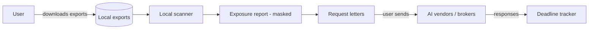

# Architecture — ai-profile-karma

## 1. Scope
Show people what AI systems could know about them from their own data, score the exposure, and
generate correction or deletion requests.
**MVP:** local scanner over user-downloaded exports (PII regex + Luhn, sensitive-category lexicon),
masked evidence, exposure score, GDPR/CCPA letter generator.
**Product:** export-fetching browser extension, continuous monitoring, request sending and deadline tracking.

## 2. System context

**Local-first by design.** Findings are about the user's most sensitive data, so the MVP never makes a network call.

## 3. Components
| Module | Responsibility | Status |
|---|---|---|
| `scan_text` | Regex PII (email, phone, address, DOB, SSN, IBAN), Luhn-validated cards, category keywords | MVP |
| `_iter_texts` / `_strings` | Read txt/md/json/csv and flatten nested JSON exports (ChatGPT `conversations.json`) | MVP |
| `exposure_score` | Distinct facts weighted by sensitivity, plus a small bonus for repetition → 0–100 | MVP |
| `request_letter` | Statute-correct article references and deadlines (GDPR Art. 15/16/17, CCPA §1798.1xx) | MVP |

## 4. Design decisions
- **Evidence is masked at creation time** (`_mask`), so raw PII never reaches the report or the terminal.
- **Distinct-fact scoring.** Mentioning your address 40 times doesn't make it 40× worse.
- **Lexicon over an ML classifier** for categories. It's transparent and offline. *Trade-off:* lower
  recall. The product adds a local small model (on-device) with the lexicon as fallback.

## 5. Future production architecture (not shipped)
Not shipped: a browser extension and desktop app (local processing, Tauri), plus an optional encrypted sync of
*findings metadata* only. A request-tracking backend stores vendor, request date and statutory
deadline, and sends reminders. The shipped product is the local scanner, score, and letter generator in §1.

## 6. Privacy
Zero-knowledge posture: the server never sees raw exports or evidence snippets. Telemetry is opt-in
and limited to counts.

## 7. Risks
Vendor export formats change, so parsers stay versioned with fixtures. Letters are templates, not
legal advice, and the product says so.
